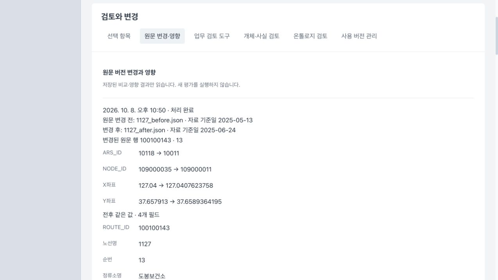
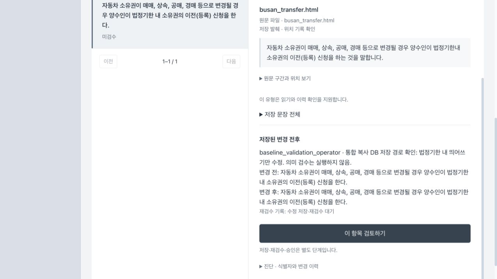

# 회사 지식 제품·워크벤치 통합 기준선 (2026-10-15)

기존 여러 작업 위치에 있던 구축·검색·원문 주소·복구 기능과 워크벤치를 최신 main 기준의 한 검토 단위로 묶었다. 새 효율 개선이나 의미 품질 완료 보고가 아니다. 최초 이식·검사 기준 main은 `bb046c2686d04219afafab83caeb61ec5889421a`, 통합 코드 검증점은 `afc8b8f0d7268c0b644d100952a806ad4dfe4c06`이다. 이후 최신 main `bebf7b3aaca0e8cabe2c29f4d2def518e48ac661`을 일반 병합했다(`c2d440ae1043d5c305c28ba7662c273b61f5b471`). #659가 추가한 147개 연구·검사·스크립트 경로는 이번 변경과 겹치지 않고 제품 실행 코드·frontend·의존 설정은 검사점과 같다. 이 기준선 문서·작은 검증 기록·화면만 추가한다.

## 포함 범위와 선행 관계

- A: 원문 Hybrid/hybrid_graph 검색과 공통 reader, 질문 없는 그래프 구축, 완료 추출 보존, 체크포인트·용량 복구·과거 실패 계보, 유일한 원문 주소/연속 공백 복원, 검증된 HTML 분류표 행과 셀별 근거, 개념화 source map·재사용 경계, 과거 상담의 공통 답변 경계, QA 재검토 중복/완료 요청 재사용 경계.
- B: 현황·자료·목록/그래프·검토/변경·저장 QA 인용의 워크벤치, 이웃 확장/키보드 목록, 현재 사용 제한과 과거 버전 구분, 같은 행의 변경/유지 필드, 지원 Event 직접 수정 저장·재조회.
- W6의 작은 후속 수정: `review_ready` 원문 QA 조회 허용, 기존 평가 연결로 `new_relevance` 산출. 전체 W6 완료 또는 새 조건 의미 영향 실증으로 해석하지 않는다.
- B는 main에 이미 있던 자료·실행·변경안·지원 Event 편집·snapshot 계약을 사용한다. A의 모든 변경에 B가 강하게 의존하는 것은 아니다. 공유 API 편집은 두 기능의 handler를 모두 보존했고, 함께 묶은 이유는 이번 통합/검토 범위다.
- C의 문서·그래프 RAG 실험·비용·채점·실패·준비 기록은 별도 연구 PR이다. 연구 파일을 제품 실행 경로로 불러오지 않는다. 자동 의미 판단 연구 #659는 현재 main에 병합 완료됐으며, 이번 RAG 연구 기록과 범위가 다르다.

## 원본·중복·미커밋 자료 처리

원본 7개 작업 위치를 변경하지 않고 별도 `codex/knowledge-baseline-product`에서 21개 제품 커밋을 순서대로 이식했다. 원래 SHA와 이식 SHA 전체는 [검증 기록](company_knowledge_baseline_20261015.json)의 `product_original_to_integration`에 있다. 혼합 커밋은 제품/연구 경로로 나눴고 원래 SHA를 커밋 본문에 남겼다. 연구 전용 `be543a89`, `545e3ad8`은 제품에서 제외했다.

| 원본 작업 위치 | 보존한 원본 HEAD | 채택 내용 |
|---|---|---|
| knowledge-html-rows | `ee376f7a6397726d2daf934075284e007ae91350` | A의 최종 구축·복구·주소·행 처리 |
| knowledge-address-links | `091345cd1890ca966b7e9dbf6f7ad4f432682c00` | A에 포함, 미구현 계획 2개는 로컬 보존 |
| document-graph-rag-comparison | `cb42d4116468d8e214ce9d23be4d50ee7ab9310c` | A의 선행 기능 + C 분리 |
| knowledge-workbench-ui | `372afbb09770c13df3847f9b387c62f4e836cf36` | B의 고유 앞 3개 |
| business-change-field-ui | `86a277fd07914e6da2c64319f1610486a73aff78` | B의 유지 필드·직접 수정 이력 |
| business-feedback-boundary | `5d4553883c34e37fa07435008cb4ec04ac1cce91` | 같은 patch ID의 A 커밋으로 한 번만 채택 |
| w6-source-run-review-ready | `cc3922f9f453ef9d02f934495dc16dbaf7229f73` | 원문 QA·기존 평가 관련성 2개 |

중복군은 `4328a8ff = f63daf64 = 6e5a5016`, `cef86b33 = d251b088 = 5d455388`이다. 각각 stable patch ID와 최종 내용을 대조해 첫 SHA만 채택했다.

미커밋/미추적 34개는 ① 이미 최신 커밋과 같은 코드/검사 5개 ② 후속 구현으로 반영된 옛 코드 3개 ③ 별도 연구 PR에 원형 복사한 기록 19개 ④ 미구현 효율 계획 2개 ⑤ UI DB/raw 5개로 분류했다. ②의 `business_concepts.py`, `source_capacity_repair.py`는 과거 복구 코드, `business_run.py`는 이후 문맥 상속·공통 prepare/partition·source map 전달로 진전한 버전이다. 옛 코드를 다시 덮어쓰지 않았다. 원본 dirty 파일·DB/raw·동결 코드·중단 원장은 로컬 그대로다.

## 이번 통합 코드에서 확인한 범위

| 확인 | 결과 | 해석 범위 |
|---|---|---|
| 변경 관련 backend 22개 파일 | 315 passed / 112.82초 | 계약·fixture 회귀 검사 |
| frontend 관련 3개 파일 | 11 passed | 변경 필드·graph presentation·usage |
| 전체 TypeScript / 변경 14개 파일 eslint / production build | 통과 | 타입·해당 파일 정적 검사·빌드 |
| 초기 잘못 넓힌 eslint | 실패 보존 | main과 같은 `DuplicateReplyDraftPanel.tsx:23`의 set-state-in-effect 오류. 전체 lint 통과 주장 없음 |
| 내용 대조 | 제품 56파일 원본 최종 bytes 일치, API handler 합집합 일치 | 이식 중 기능 누락 여부 |
| 실제 브라우저 | production FE + 통합 실제 router, D01/서울/부산 별도 복사 DB | 아래 저장·조회 동선, 새 모델 실행 없음 |

D01 `융자제한기업`의 CR1 관계를 선택해 미승인·조건·업력/자산 예외·원문을 읽었고 8대상/9관계→20대상/22관계 확장 및 키보드 대상 선택을 확인했다. 고정금리 저장 QA의 연2.0% 실제 인용과 비인용 제공 근거도 읽었다. 저장 답변 조회는 현재 생성/의미 검증이 아니다.

서울 순번13의 ARS_ID/NODE_ID/X/Y 4변경과 ROUTE_ID/노선명/순번/정류소명 4동일, 동일 행59개 표시를 확인했다. 이전 snapshot 요구 제한5/새0, 현재 원장 needs_review0을 구분했다. 옛 전체 후보의 주장1개·block1개 제외는 유지된다. 저장 QA12/13은 `succeeded/answered`이지만 `BUS-NEW-13` 요구는 `partial`이다. 사용 제한 없음·후보 자격 수가 승인·활성화·의미 정확성을 뜻하지 않는다.

부산은 등록 자료2/버전2/원문171구간의 복사 DB에서 기존 Event의 `법정기한내`→`법정기한 내` 띄어쓰기만 수정했다. 근거 미선택 오류 뒤 입력 보존, 근거 선택·이중 클릭에서 POST/worker 각1, 새 run 재조회·원문·작성자·사유·변경 전후를 확인했다. 예전 revision 재저장은409였고 새 run은1개다. 다른 주장/Entity/기존 run·snapshot·요구/활성 상태는 유지되고 해당 변경안의 revision·edit/invalidation 기록만 의도대로 바뀌었다. 진단 worker를 모델 직전에 멈춰 새 run은 `failed`/`W6_diagnostic_stop_before_model`, 모델 호출0이다. 저장 성공과 의미 재검수 성공을 구분한다. QA 답변 재검토의 멱등 경계는 backend/API 검사이며 UI 버튼 검증이 아니다.

## 남은 한계와 제외 범위

- D01 과거 dates의 `kind=document_year`와 UI의 `role` 기대가 달라 `(undefined) 2019`가 보이는 기존 표시 결함이 남는다. `knowledgeWorkbench.ts`는 원래 UI HEAD와 같고 이번 통합에서 새로 만든 결함이 아니다.
- 확장한 밀집 그래프의 라벨 겹침/선 교차가 남는다. 가독성 완성·대규모 성능·접근성 인증을 주장하지 않는다.
- 새 조건 관련성·같은 block의 독립 의미 보존·OR 누락 자동검출·자동 의미 교정·전체26문항 비교는 완료하지 않았다. #616/#617/#620/#660을 이 PR로 종료하지 않는다. UI #661~#663은 이미 닫힌 상태이며 새로 만들지 않는다.
- 중단한 전역 개념화의 응답 완료922(174재사용+748신규, 의미 정확성 검증 완료가 아님), 사용자 취소1, 미시도2699와 재개 기록은 그대로다. 사용자 취소를 의미 실패로 세지 않고 자동 재개하지 않았다.
- main 브랜치로 PR 병합/배포·새 모델 호출·묶음 개념화·문맥 축소·새 효율 기능은 수행하지 않았다. 로컬 로그·원시 run 응답·원본 DB는 공유 PR에 넣지 않는다.

세부 명령 대상, 원본→이식 SHA, 실제 run/claim/evidence ID, 원자료 SHA 및 로컬 검증 경로는 동명 JSON을 참조한다. 이번 기록은 로컬 검증이며 원격 CI 결과는 PR의 실제 check 목록에서 따로 확인한다.
